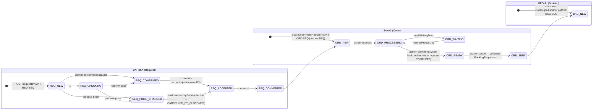

# Как заявка переводится в заказ — наглядный разбор (TravelHub)

Отчёт только по коду и документам (read-only, код не менялся). Актуально на октябрь 2026.

---

## 1. Общая картина: одна коммерческая цепочка — три номера

Вся жизнь сделки привязана к **общему корню последовательности** `commerceSequence`,
выдаваемому при создании заявки из атомарного счётчика `events."BusinessSequence"`
(Hi/Lo-кэш blockSize=100, `ReferenceNumberService` / `IdsService`, см. [docs/contracts/ids.md](docs/contracts/ids.md)):

```
MKT-REQ-123  ──конверсия──►  MKT-ORD-123  ──send──►  MKT-BKG-123
 (Request)                    (Order)                 (Booking)
```

Номер заказа **не новый**: `createOrderFromRequest` переиспользует root заявки
([order.service.ts:673](backend/src/modules/order/order.service.ts#L673) — «переиспользуем
shared commerce root заявки (НЕ новая последовательность): MKT-REQ-{SEQ} → MKT-ORD-{SEQ}»).
Внутренние ID: `REQ-*` → `ORD-*` (`ORD-` + `TH-YYYY-######` пользовательский номер).

---

## 2. Пошаговая цепочка (end-to-end)

### Этап A — Заявка (Request)

| # | Endpoint | Метод | Статус заявки | Что происходит |
|---|---|---|---|---|
| 1 | `POST /api/v1/requests` | `RequestService.createRequest` ([request.service.ts:226](backend/src/modules/order/request.service.ts#L226)) | `NEW` | Выдаётся `commerceSequence` + `MKT-REQ-*`; снапшот продукта (productId **опционален** — снапшот может быть null); SLA поставщику; запись в `RequestHistory` + audit |
| 2 | `POST /requests/:id/confirm-price` | `confirmPrice` → `supplierAction(..., "CONFIRMED")` | `NEW`/`CHECKING` → `CONFIRMED` | Поставщик подтверждает цену. Альтернатива: `proposePrice` → `PRICE_CHANGED` (новая цена + дедлайн клиенту), `rejectRequest`, `markUnavailable` |
| 3 | `POST /requests/:id/customer-accept` | `customerAccept` ([request.service.ts:764](backend/src/modules/order/request.service.ts#L764)) | `PRICE_CHANGED`/`CONFIRMED` → `CUSTOMER_ACCEPTED` | **Acceptance boundary (D3) — заморозка в одной транзакции:** `customerAcceptedAt` (реальный instant), `pinnedRequirements` (требования к туристам из Product policy), `travelerCount` (frozen party size), `confirmedPrice/Currency`, frozen `commercialSnapshot`. Money-gate: accept никогда не сохраняет 0/пустые деньги (422) |

### Этап B — Конверсия (магия здесь)

| # | Endpoint | Метод | Что происходит |
|---|---|---|---|
| 4 | `POST /requests/:id/convert` | `RequestService.convertRequestToOrder` ([request.service.ts:944](backend/src/modules/order/request.service.ts#L944)) → `OrderService.createOrderFromRequest` ([order.service.ts:605](backend/src/modules/order/order.service.ts#L605)) | В **одной транзакции**: CAS-claim `CUSTOMER_ACCEPTED → CONVERTED` (первое действие — идемпотентность, двойной convert даёт одного победителя); создаётся Order-граф; Request линкуется (`convertedOrderId`, `convertedAt = Order.createdAt`); история + audit; событие `OrderCreated` пишется PENDING (outbox) и доставляется **после коммита** |

Гейты конверсии (если нарушены — 409/422):
- статус строго `CUSTOMER_ACCEPTED`;
- `customerAcceptedAt` и `travelerCount ≥ 1` (D3-снапшот) существуют;
- есть деньги: `confirmedPrice ?? displayedPrice` + валюта;
- productId **не требуется** — OrderItem получит placeholder identity («Услуга без продукта»);
- повторный convert — идемпотентный ответ с тем же Order; третий вариант (convertedOrderId есть, но статус другой) → 409 «one Order per commerce sequence».

Что создаёт `createOrderFromRequest`:

```
Order (NEW, UNPAID)
 ├─ amount = accepted money, currency
 ├─ termsAcceptedAt = Request.customerAcceptedAt   (не createdAt заказа!)
 ├─ pinnedRequirements = замороженный снапшот требований
 ├─ commercialSnapshot = verbatim из Request (immutable)
 ├─ OrderItem ×1      — whole-request money snapshot (цена всей заявки, unit price не фабрикуется)
 ├─ OrderTraveler ×N  — placeholders position 1..N, dataCompleteness=INCOMPLETE
 ├─ Fulfillment       — NOT_STARTED
 ├─ OrderHistory      — "created"
 └─ Outbox: OrderCreated (PENDING → доставка после коммита)
```

### Этап C — Заказ (Order) до брони

| # | Endpoint | Действие | Статус заказа |
|---|---|---|---|
| 5 | `PATCH /orders/:id {action:"process"}` | Принят в работу | `NEW → IN_PROCESSING` |
| 6 | `PATCH /orders/:id/travelers` (bulk или `/travelers/:tid`) | Заполнение данных туристов (D3 collection) | — |
| 7 | `POST /orders/:id/final-confirm` | **D3-гейт**: данные всех туристов COMPLETE; блокирует мутации туристов (row lock FOR UPDATE) | `finalConfirmedAt` проставлен |
| 8 | `PATCH /orders/:id {action:"confirm"}` | Готов к бронированию; событие `OrderReadyForBooking` (бронь НЕ запускает) | `→ READY_FOR_BOOKING` |
| 9 | `PATCH /orders/:id {action:"send"}` | Передача в Booking Center; событие **`BookingRequested`** ([order.service.ts:1650](backend/src/modules/order/order.service.ts#L1650), payload минимизирован: только orderId/orderCode/customerId) | `→ SENT_TO_BOOKING` |
| 10 | consumer `BookingSubscribers` ([booking.subscribers.ts](backend/src/modules/booking/booking.subscribers.ts)) | Читает order.items/travelers (READ-only), на каждый **свободный** OrderItem создаёт `Booking` (BKG-*, NEW) + Passenger из COMPLETE-туристов; идемпотентность через `events.InboxEvent`; per-item occupancy (Q9) | Бронь появляется через 1–3 c: `GET /bookings?orderId=` |

Важно: `POST /bookings` напрямую **не существует** — бронь создаётся только событием `BookingRequested`.

---

## 3. Машина состояний (mermaid)



---

## 4. Ключевые инварианты (почему так, а не иначе)

1. **Один Order на коммерческую цепочку.** `Order.referenceNumber` (MKT-ORD-{SEQ}) `@unique`; повторная конвертация — 409.
2. **Идемпотентность через CAS.** И convert, и orderAction делают `updateMany` с проверкой `status + version` — гонки дают ровно одного победителя, повторный вызов возвращает существующий результат.
3. **Frozen facts.** После `customer-accept` цена/требования/состав — immutable snapshot. Продукт перечитывается только в момент accept; изменение Product позже не влияет на принятые деньги и на Order.
4. **Money не фабрикуется.** OrderItem = цена всей заявки; ни unit-price-деривации из party size, ни нулевых accept-ов.
5. **Outbox-паттерн.** `OrderCreated` / `BookingRequested` пишутся атомарно с транзакцией (PENDING) и доставляются подписчикам после коммита; consumer-ы идемпотентны через InboxEvent.
6. **D3-гейт перед бронью.** `confirm`/`send` требуют `finalConfirmedAt` и полных данных всех туристов (см. `computeAvailableOrderActions`, [order.service.ts:168](backend/src/modules/order/order.service.ts#L168)); порядок шагов строгий — `final-confirm` ДО `confirm`, иначе 422 «requires final traveler confirmation».
7. **Обратный путь (Stage 1).** `action:"returnToRequest"` атомарно: Order → CANCELLED, Request → CHECKING (реактивация в той же транзакции), link сохраняется.
8. **Права (RBAC).** Действия заказа защищены гранулярными правами: `order.accept`, `order.edit_noncritical`, `order.request_booking` (send), `order.close`, `order.cancel` (`ACTION_PERMISSIONS`, [order.service.ts:134](backend/src/modules/order/order.service.ts#L134)).

## 5. Где смотреть руками

- Живая демонстрация шагов 1–10 одним прогоном: [frontend/components/commerce/ManualCreateForm.tsx:158–191](frontend/components/commerce/ManualCreateForm.tsx) (кнопка «Создать вручную» в UI — точное зеркало этой цепочки).
- История по конкретной заявке/заказу: таблицы `order.RequestHistory` и `order.OrderHistory` (каждый шаг пишет action/from/to/actor).
- Номера в БД: `events."BusinessSequence"` (счётчики), `order.Order.referenceNumber`.
- Документы: [docs/chapter-7-order-center.md](docs/chapter-7-order-center.md), [docs/architecture/order-lifecycle-completion.md](docs/architecture/order-lifecycle-completion.md), [docs/architecture/booking-requested-to-booking-creation.md](docs/architecture/booking-requested-to-booking-creation.md), [docs/contracts/ids.md](docs/contracts/ids.md).
