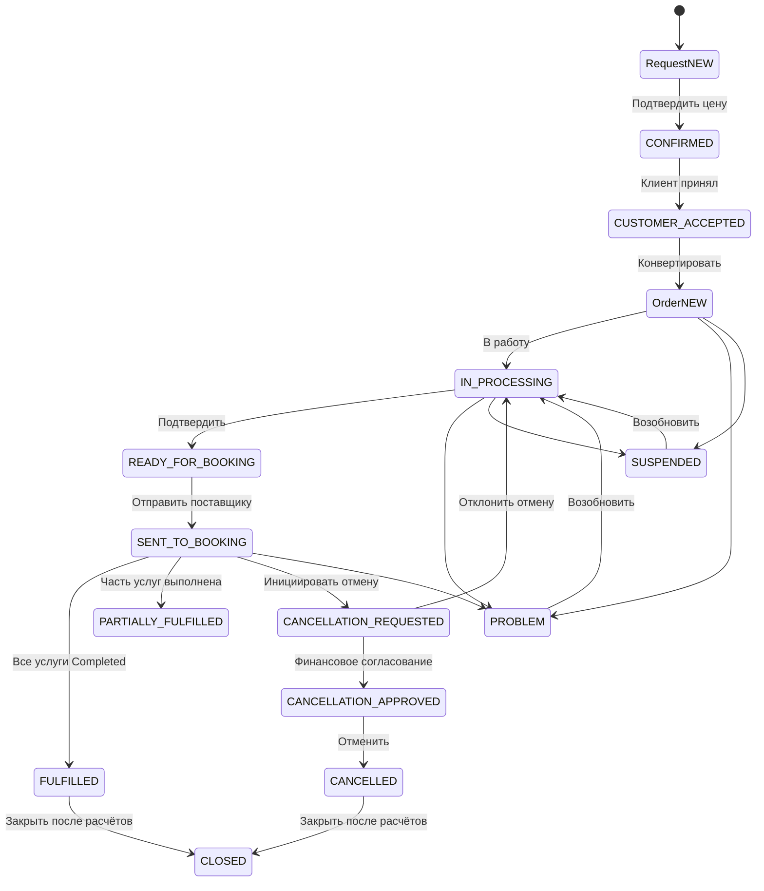

# Navitravel — аудит жизненного цикла сделки

Дата: 2026-11-07  
Статус: **ЧАСТИЧНО ЗАВЕРШЕНО**. Основные маршруты, отмена, частичные финансы, USD и multi-supplier проверены. Полный Jest suite не зелёный.

## 1. Граф жизненного цикла



## 2. Проверенные маршруты

| № | Переход | Проверка | Результат |
|---|---|---|---|
| 1 | Request NEW → CONFIRMED | API | PASS |
| 2 | CONFIRMED → CUSTOMER_ACCEPTED | API | PASS |
| 3 | CUSTOMER_ACCEPTED → Order NEW | API/DB | PASS |
| 4 | Order NEW → IN_PROCESSING | API | PASS |
| 5 | IN_PROCESSING → READY_FOR_BOOKING | API | PASS |
| 6 | READY_FOR_BOOKING → SENT_TO_BOOKING | API/DB | PASS |
| 7 | Booking NEW → SENT_TO_SUPPLIER | API | PASS |
| 8 | SENT_TO_SUPPLIER → CONFIRMED | API | PASS |
| 9 | CONFIRMED → IN_SERVICE → COMPLETED | API | PASS |
| 10 | Booking reject → returnToOrder → re-send | API | PASS |
| 11 | Booking change → resolve change | API | PASS |
| 12 | Booking cancel | API | PASS |
| 13 | Order PROBLEM → resume | API | PASS |
| 14 | Order SUSPENDED → resume | API | PASS |
| 15 | SUSPENDED → close/cancel | API 409 | PASS |
| 16 | Cancellation request → finance approve | API | PASS |
| 17 | CANCELLATION_APPROVED → CANCELLED | API | PASS |
| 18 | CANCELLED → CLOSED | API | PASS |
| 19 | Self-approval отмены | API 409 | PASS |
| 20 | Close с долгами | API 409 | PASS |
| 21 | Complete с долгами | API | PASS после разделения guards |
| 22 | Multi-supplier: 2 услуги / 2 terms | API/DB | PASS |
| 23 | USD: 100 / 40 / 60 / 20 | API/DB | PASS |
| 24 | Возврат клиенту раньше поставщика | API/KPI | PASS |
| 25 | Нумерация двух броней | API/DB | PASS |

## 3. Исправленные дефекты

### D1. Тупик согласования отмены
`approveCancellationApproval` вызывал `confirm()`, который требует CANCELLED/COMPLETED. Заказ в CANCELLATION_REQUESTED не мог быть согласован или отменён. Исправлено: согласование переводит Order в CANCELLATION_APPROVED, расчёт выполняется после отмены.

### D2. Complete/close при активной брони
Добавлена проверка отсутствия активных Booking; projection скрывает действия.

### D3. Отменённая закрытая сделка выглядела выполненной
Терминальные брони больше не определяют stage; метка «Отменена и закрыта» по `isCancelledDeal`.

### D4. Font.register ломал Jest
Добавлена проверка `Font && typeof Font.register === "function"`.

### D5. Unit-моки PaymentService
Notification-вызовы защищены проверкой наличия delegate.

### D6. Complete ошибочно требовал погашения долгов
`complete` проверяет только активные брони; `close` — долги, возвраты и согласование.

### D7. Close guard и KPI считали supplierDebt по-разному
Guard использует ту же формулу, что DealsService: obligation учитывается только при `obligationCost < sale`.

### D8. Resume терял предыдущий статус
Восстанавливается `from` последней history `problem`/`suspend`; при активной брони — SENT_TO_BOOKING. History/audit/outbox пишут targetStatus.

### D9. CLOSED отменённая сделка получала supplierDebt
Долг считается по признаку `cancelledAt`, а не только по статусу CANCELLED.

### D10. Номер платежа дублировал sequence
`MKT-PAY-{seq}-{seq}-1` исправлен на `MKT-PAY-{seq}` / `MKT-PAY-{seq}-1`.

### D11. Нумерация нескольких броней начиналась с -1
Первая бронь теперь `MKT-BKG-{seq}`, вторая `-1`.

### D12. Все отменённые брони переводили Order в FULFILLED
`allDone` включал CANCELLED/SUPPLIER_REJECTED. Теперь FULFILLED только при всех COMPLETED; иначе PARTIALLY_FULFILLED или READY_FOR_BOOKING.

## 4. Финансовые проверки

### Частичная отмена, AZN
```text
Продажа 100; оплачено клиентом 100; возврат 40
Оплачено поставщику 60; возврат 20
F = (100 − 40) − (60 − 20) = 20
supplierDebt = 0 после списания 40
```

### USD, возврат клиенту раньше поставщика
```text
После возврата клиенту 40 и до возврата поставщика:
F = (100 − 40) − 60 = 0
supplierDebt = 60

После возврата поставщика 20:
F = 20
supplierDebt = 40

После списания 40:
supplierDebt = 0; clientDebt = 0; status = CLOSED
```

## 5. Уведомления

Проверены через API:

```text
problem          → ORDER_PROBLEM
resumeProcessing → ORDER_RESUMED
orderEvents = 2
```

Типы: ORDER_PROBLEM, ORDER_SUSPENDED, ORDER_RESUMED, ORDER_CANCELLATION_REQUESTED, ORDER_CANCELLATION_APPROVED, ORDER_CANCELLED, ORDER_FULFILLED, ORDER_CLOSED.

В UI — отдельные иконки/цвета и переход в карточку сделки.

## 6. Тесты

Точечный прогон:

```text
order-actions.active-booking.spec.ts            2/2 PASS
deals.kpi.spec.ts                               PASS
order-financial-settlement.calculator.spec.ts   PASS
booking-to-order.projection.spec.ts             PASS
```

Полный suite (до последних правок):

```text
Test Suites: 11 failed, 177 passed, 188 total
Tests:       20 failed, 2829 passed, 2849 total
```

Оставшиеся FAIL: устаревшие ожидания тестов (`cancel` vs `requestCancellation`, PII SALES_MANAGER, passport-поля Request, hotel 1–3*), mock `assign`, env `WHATSAPP_ENABLED`, constructors `AzalController`/`RequestService`, отсутствие cancelled-фикстуры.

## 7. Ограничения

- Полный Jest suite не зелёный.
- D12 проверен сборкой, но не повторным API-прогоном «все брони отменены».
- Не проверено частичное выполнение до отмены (одна услуга выполнена, вторая отменена).
- Не проверены несколько валют в одной сделке и возврат поставщика раньше клиента.

## 8. Итог

```text
Request → Order → Booking             PASS
Booking complete / reject / change    PASS
Problem / Suspend / Resume            PASS
Cancellation approval → close         PASS
Partial finance / penalties / writeoff PASS
Multi-supplier                        PASS
USD + refund ordering                 PASS
Booking/payment numbering             PASS
Lifecycle notifications               PASS
Cancelled bookings → FULFILLED guard  PARTIAL (код)
Full Jest suite                       FAIL
```

Коммиты:

```text
e5d58cb fix: close lifecycle gaps in cancellation, completion and deal stage
48da1d8 test: keep payment unit mocks compatible with notifications
73aa0b8 fix: cancelled closed debt and uniform payment reference
803b200 fix: sequential booking reference numbering across order items
6725057 feat: lifecycle order notifications and booking numbering verification
9437eb4 fix: cancelled bookings no longer fulfill order
```
