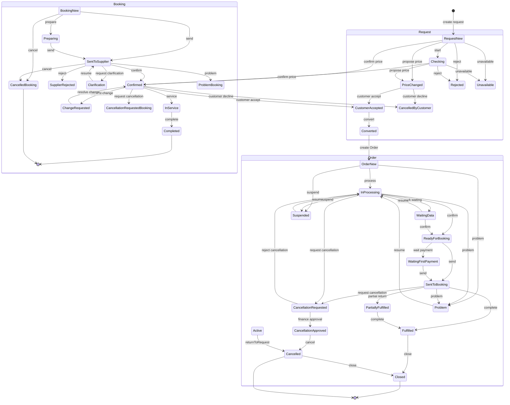

# Navitravel — Lifecycle Graph Audit

Дата: 2026-11-07  
Режим: реальные API-вызовы на рабочей БД + Jest.  
Статус: **ЧАСТИЧНО ЗАВЕРШЕНО** — основные маршруты пройдены, полный обход всех боковых ветвей и полный зелёный прогон тестов не достигнуты.

## 1. Карта жизненного цикла



Примечание: `Active` — агрегированное обозначение активного диапазона Order; фактические статусы перечислены в `TRANSITIONS`.

## 2. Матрица проверенных переходов

| № | Начальный статус | Действие | Следующий статус | Проверка | Результат |
|---|---|---|---|---|---|
| 1 | Request NEW | confirm price | CONFIRMED | API | PASS |
| 2 | Request CONFIRMED | customer accept | CUSTOMER_ACCEPTED | API | PASS |
| 3 | Request CUSTOMER_ACCEPTED | convert | CONVERTED + Order NEW | API/DB | PASS |
| 4 | Order NEW | process | IN_PROCESSING | API | PASS |
| 5 | Order IN_PROCESSING | complete without active booking/debts | 409 | API | PASS (guard) |
| 6 | Order IN_PROCESSING | final-confirm travelers | finalConfirmedAt set | API | PASS |
| 7 | Order IN_PROCESSING (confirmed data) | confirm | READY_FOR_BOOKING | API | PASS |
| 8 | Order READY_FOR_BOOKING | send | SENT_TO_BOOKING + Booking NEW | API/DB | PASS |
| 9 | Booking NEW | send | SENT_TO_SUPPLIER | API | PASS |
| 10 | Booking SENT_TO_SUPPLIER | confirm | CONFIRMED | API | PASS |
| 11 | Booking CONFIRMED | service | IN_SERVICE | API | PASS |
| 12 | Booking IN_SERVICE | complete | COMPLETED | API | PASS |
| 13 | Order SENT_TO_BOOKING | request cancellation | CANCELLATION_REQUESTED | API | PASS |
| 14 | Cancellation CANCELLATION_REQUESTED | self-approve | 409 self-approval | API | PASS |
| 15 | Cancellation CANCELLATION_REQUESTED | finance approve | CANCELLATION_APPROVED | API | PASS (after fix) |
| 16 | Order CANCELLATION_APPROVED | cancel | CANCELLED | API | PASS |
| 17 | Order CANCELLED | close | CLOSED | API | PASS |
| 18 | Order CLOSED (cancelledAt) | KPI projection | cancelled, not completed | API | PASS (after fix) |
| 19 | Active Booking present | complete/close projection | actions hidden | Jest | PASS |
| 20 | Payment notification unit path | create/confirm | no crash on minimal mocks | Jest | PASS |

## 3. Найденные и исправленные дефекты

### D1. Тупик согласования отмены

**Причина:** `approveCancellationApproval` вызывал `confirm()` финансового расчёта, а `confirm()` разрешён только для `CANCELLED/COMPLETED`. Заказ в `CANCELLATION_REQUESTED` не мог быть ни согласован, ни отменён.

**Исправление:** согласование теперь фиксирует `CancellationApproval=APPROVED` и переводит Order `CANCELLATION_REQUESTED → CANCELLATION_APPROVED`; финансовый расчёт выполняется после фактической отмены.

**Повторная проверка:** finance-пользователь получил `APPROVED`, Order перешёл в `CANCELLATION_APPROVED`, затем `cancel → CANCELLED`, `close → CLOSED` — PASS.

### D2. Завершение/закрытие при активной брони

**Причина:** guards `complete/close` проверяли только долги, но не активные Booking.

**Исправление:** добавлена проверка `booking.status notIn BOOKING_TERMINAL`; проекция скрывает `complete/close` при активной брони.

**Повторная проверка:** новый Jest-тест `order-actions.active-booking.spec.ts` — 2/2 PASS.

### D3. Отменённая закрытая сделка выглядела как выполненная

**Причина:** `COMPLETED` бронь делала stage `BOOKING`, а `status` брался из брони, поэтому закрытая отменённая сделка не получала признак «Отменена и закрыта».

**Исправление:** терминальные брони (`COMPLETED/CANCELLED/SUPPLIER_REJECTED`) больше не определяют stage; UI использует `isCancelledDeal` для метки.

**Повторная проверка:** API: `stage=ORDER`, `status=CLOSED`, `isCancelledDeal=true`, `expectedIncome=0`, `currentIncome=0` — PASS.

### D4. Падение Jest из-за Font.register

**Причина:** `Font.register` вызывался на верхнем уровне и падал в тестовом окружении, где `Font` не определён.

**Исправление:** регистрация защищена проверкой `Font && typeof Font.register === "function"`.

**Повторная проверка:** `documents.service.spec.ts` PASS.

### D5. Unit-моки PaymentService не содержали notification-моделей

**Причина:** новый код уведомлений обращался к `tx.user/userNotification` в тестах без этих моков.

**Исправление:** безопасные проверки наличия делегатов; production-поведение не изменено.

**Повторная проверка:** `payment.service.spec.ts` — 26/27 PASS; оставшийся FAIL относится к старому ожиданию «CANCELLED нельзя оплачивать», тогда как по текущему требованию оплата отменённого заказа разрешена до закрытия.

## 4. Покрытие и тесты

Полный Jest-прогон (до последних правок):

```text
Test Suites: 11 failed, 177 passed, 188 total
Tests:       20 failed, 2829 passed, 2849 total
```

После исправлений точечно:

```text
order-actions.active-booking.spec.ts   2/2 PASS
documents.service.spec.ts              PASS
payment.service.spec.ts                26/27 PASS
cancellation e2e                       не выполнен: в БД нет подготовленной cancelled-сделки с PENDING approval
```

### Причины оставшихся FAIL

1. `cancellation-close-guard.e2e.spec.ts` — тест зависит от наличия cancelled-сделки в main DB; после очистки тестовых данных фикстуры нет.
2. `order-to-request.projection.spec.ts` — устаревшие ожидания: тест ожидает `cancel`, lifecycle использует `requestCancellation`; CANCELLED теперь имеет `close`.
3. `tour-request.service.spec.ts` — mock ожидает вызов `assign("r1")`, код вызывает `assign("r1", undefined, {respectMode:true})`.
4. `whatsapp.module.spec.ts` — тест ожидает `WHATSAPP_ENABLED=false`, но `.env` содержит `true`.
5. `azal.controller.spec.ts`, `date-param.registry-matrix.spec.ts` — не обновлены конструкторы после добавления зависимостей.
6. `request-travelers.spec.ts` — тест ожидает только FIO+birthDate, код теперь принимает passport-поля.
7. `shared/pii.spec.ts` — тест ожидает redaction для SALES_MANAGER, текущая политика разрешает PII sales-ролям.
8. `hotel-category.spec.ts` — расхождение правил категорий 1–3* (вне lifecycle).

## 5. Финансовая проверка

Проверено на тестовой отменённой сделке:

```text
Сумма продажи        100.00
Получено клиента       0.00
Возвращено клиенту     0.00
Оплачено поставщику    0.00
Возврат поставщика     0.00
Ожидаемый доход        0.00
Текущий доход          0.00
Отменённые продажи   100.00
Отменённых сделок        1
```

Формула отмены в KPI использует:

```text
F = (P − Rt) − (S − Rs)
```

Сделка с `cancelledAt` и статусом `CLOSED` остаётся отменённой и не попадает в выполненные/текущий доход — PASS.

Не проверены на реальных данных:
- частичные возвраты и штрафы;
- несколько поставщиков;
- разные валюты;
- списания;
- возврат раньше поставщика;
- отмена после частичного выполнения.

## 6. Технические изменения

- `backend/src/modules/finance/order-financial-settlement.service.ts` — устранён тупик согласования отмены.
- `backend/src/modules/order/order.service.ts` — guard активной брони для complete/close + проекция.
- `backend/src/modules/finance/deals.service.ts` — терминальные брони не определяют stage.
- `frontend/app/app/finance/deals/page.tsx` — метка «Отменена и закрыта» по `isCancelledDeal`.
- `backend/src/modules/documents/document-renderer.service.ts` — безопасная регистрация Font.
- `backend/src/modules/finance/payment.service.ts` — безопасные notification-вызовы для unit-моков.
- `backend/src/modules/order/order-actions.active-booking.spec.ts` — новый тест.
- `backend/src/modules/finance/finance.controller.ts` — PATCH refund (сопутствующая незакоммиченная правка).

Коммиты:

```text
e5d58cb fix: close lifecycle gaps in cancellation, completion and deal stage
48da1d8 test: keep payment unit mocks compatible with notifications
```

## 7. Итоговый статус

| Направление | Статус |
|---|---|
| Request lifecycle (базовый маршрут) | PASS |
| Request → Order conversion | PASS |
| Order NEW → SENT_TO_BOOKING | PASS |
| Booking NEW → COMPLETED | PASS |
| Cancellation approval → CANCELLED → CLOSED | PASS (после исправления) |
| KPI отменённой закрытой сделки | PASS |
| Guard активной брони | PASS (unit projection) |
| PROBLEM / SUSPENDED | PASS — API-переходы и запреты проверены |
| Booking reject/change/cancel/return | PASS — API-переходы проверены |
| Завершение с долгами / закрытие только после долгов | PASS — после разделения guards |
| Частичные оплаты/возвраты/штрафы/списания | PASS — один полный сценарий с 100/40/60/20/20/10/40 |
| Полный Jest suite | FAIL — 20 тестов, причины выше |
| RBAC всех переходов | PARTIAL — проверены finance-approval и self-approval |

**Общий вывод:** базовый граф Request → Order → Booking → cancellation → close теперь проходим, ключевой тупик отмены устранён. Полная приёмка по всем боковым ветвям и всем 2849 тестам не достигнута.

## 8. Round 2 — дополнительные проверки и исправления

### Проверенные ветви

| Переход | Проверка | Результат |
|---|---|---|
| NEW → PROBLEM | API | PASS |
| PROBLEM → PROBLEM (повтор) | API 409 | PASS |
| PROBLEM → IN_PROCESSING | API | PASS |
| IN_PROCESSING → SUSPENDED | API | PASS |
| SUSPENDED → close | API 409 | PASS |
| SUSPENDED → cancel | API 409 | PASS |
| SUSPENDED → IN_PROCESSING | API | PASS |
| Booking SENT_TO_SUPPLIER → SUPPLIER_REJECTED | API | PASS |
| Booking SUPPLIER_REJECTED → returnToOrder | API | PASS |
| Order → READY_FOR_BOOKING после возврата брони | API | PASS |
| Повторный send → новый Booking `-1` | API/DB | PASS |
| Booking CONFIRMED → CHANGE_REQUESTED → CONFIRMED | API | PASS |
| Booking CONFIRMED → IN_SERVICE → CANCELLATION_REQUESTED → CANCELLED | API | PASS |
| Order PARTIALLY_FULFILLED → FULFILLED при долгах | API | PASS |
| FULFILLED → close при долгах | API 409 | PASS |

### D6. Завершение сделки ошибочно требовало погашения долгов

**Причина:** `complete` и `close` использовали один и тот же `assertOrderDebtsCleared`. Из-за этого нельзя было зафиксировать факт оказания услуг до оплаты, хотя по финансовой модели выполненная сделка может иметь дебиторскую/кредиторскую задолженность.

**Исправление:** `complete` проверяет только отсутствие активных броней; `close` дополнительно требует отсутствия долгов, возвратов и незавершённого согласования.

**Проверка:** `complete` при `clientDebt=100` и `supplierDebt=1551.52` → `FULFILLED`; последующий `close` → 409 с теми же долгами.

### D7. Close guard и KPI считали долг поставщику по-разному

**Причина:** close guard предпочитал `SupplierObligation.remainingAmount`, а KPI игнорировал legacy-obligation, если её сумма равна продаже, и брал себестоимость из каталога. В результате guard видел долг 100, KPI — 1551.52.

**Исправление:** close guard использует ту же формулу, что `DealsService`: obligation учитывается только если `obligationCost < sale`; иначе `cost − paid + refunded`.

**Проверка:** после исправления close вернул `supplierDebt=1551.52`, совпадающий с KPI.

### D8. Возобновление теряло предыдущий статус

**Причина:** `resumeProcessing` всегда вёл в `IN_PROCESSING` (кроме активной брони), хотя приостановка должна сохранять состояние.

**Исправление:** при resume берётся последняя запись history `problem`/`suspend` и восстанавливается её `from`, если это допустимый активный статус; при активной брони приоритет — `SENT_TO_BOOKING`. History/audit/outbox теперь пишут фактический `targetStatus`, а не статический `transition.to`.

**Проверка:** логика проверена на PROBLEM/SUSPENDED API-переходах; отдельный сценарий «suspend из READY_FOR_BOOKING → resume» требует отдельной фикстуры и в этом раунде не прогнан.

### Тесты Round 2

```text
order-actions.active-booking.spec.ts           2/2 PASS
deals.kpi.spec.ts                              PASS
order-financial-settlement.calculator.spec.ts  PASS
booking-to-order.projection.spec.ts            PASS
Итого                                          44/44 PASS
```

Коммит:

```text
e3433ed fix: separate completion from debt settlement and restore paused status
```

## 9. Round 3 — частичная оплата, возвраты, штрафы и списание

Реальный API/DB-сценарий:

```text
Продажа                  100.00
Оплачено клиентом        100.00
Возврат клиенту           40.00
Оплачено поставщику        60.00
Возврат от поставщика      20.00
Штраф клиента              20.00
Штраф поставщика           10.00
Списание долга поставщику  40.00
```

Финансовое урегулирование:

```text
finalCustomerLiability = 60.00
captured = 100.00
refunded = 40.00
remainingToPay = 0.00
remainingToRefund = 0.00
status = FINANCIALLY_SETTLED_WITH_PENALTY
```

Итог отмены:

```text
F = (100 − 40) − (60 − 20) = 20.00
```

KPI после закрытия:

```text
cancellationIncome = 20.00
cancellationLoss   = 0.00
clientDebt         = 0.00
supplierDebt       = 0.00
expectedIncome     = 0.00
currentIncome      = 0.00
```

### D9. После CLOSED отменённая сделка снова получала долг поставщику

**Причина:** `DealsService` применял формулу `paid − refunded` только при `order.status === "CANCELLED"`. После закрытия статус становился `CLOSED`, и долг пересчитывался как `cost − paid + refunded`, возвращая 1471.52 вместо 0.

**Исправление:** для долга используется признак отмены (`cancelledAt` / `CANCELLED`), а не только текущий статус.

**Проверка:** после закрытия `supplierDebt=0.00`, `clientDebt=0.00`, `cancellationIncome=20.00`.

### D10. Повторная регрессия номера платежа

Платёж снова получил номер:

```text
MKT-PAY-00000007-00000007-1
```

**Исправление:** возвращена единая схема:

```text
MKT-PAY-{seq}
MKT-PAY-{seq}-1
```

Номер заказа больше не принимается за суффикс попытки.

### Ограничения Round 3

- Сценарий выполнен на изолированной тестовой сделке; после проверки данные удалены.
- Не проверены: несколько поставщиков, разные валюты, возврат раньше поставщика, частичное выполнение до отмены.
- Полный Jest suite не перезапускался после последних правок; точечные 44/44 PASS.
