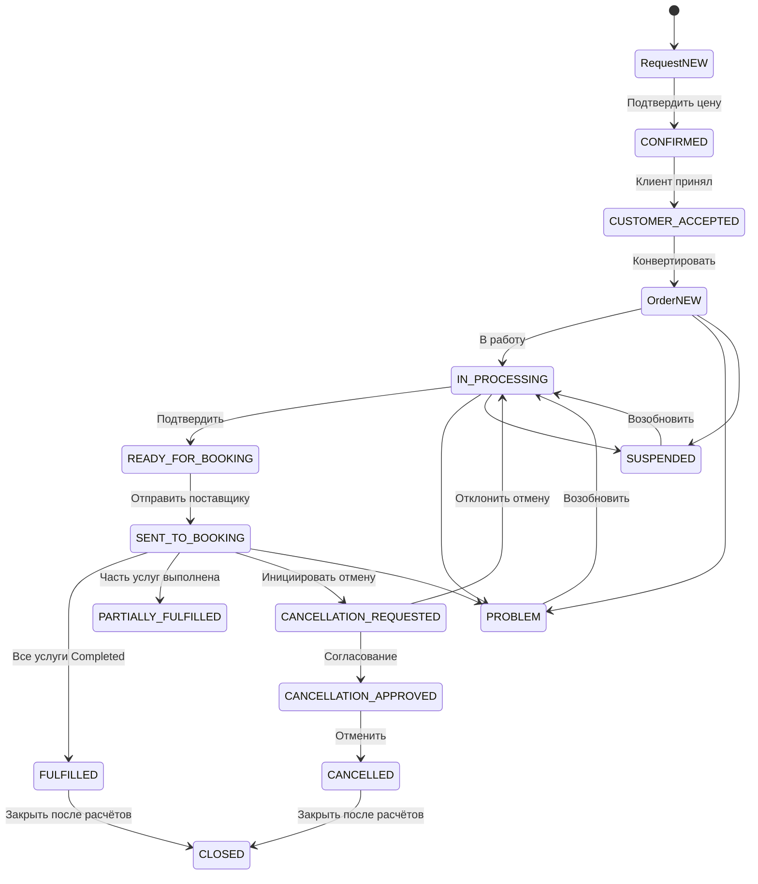

# Navitravel — аудит жизненного цикла сделки

Дата: 2026-11-08  
Статус: **ЧАСТИЧНО ЗАВЕРШЕНО**. Основные маршруты, отмена, частичные финансы, мультипоставщик, USD, порядок возвратов, нумерация и lifecycle-уведомления проверены. Полный Jest suite не зелёный.

## 1. Граф



## 2. Матрица проверенных переходов

| № | Переход | Проверка | Результат |
|---|---|---|---|
| 1 | Request NEW → CONFIRMED | API | PASS |
| 2 | CONFIRMED → CUSTOMER_ACCEPTED | API | PASS |
| 3 | CUSTOMER_ACCEPTED → Order NEW | API/DB | PASS |
| 4 | Order NEW → IN_PROCESSING | API | PASS |
| 5 | IN_PROCESSING → READY_FOR_BOOKING | API | PASS |
| 6 | READY_FOR_BOOKING → SENT_TO_BOOKING | API/DB | PASS |
| 7 | Booking NEW → SENT_TO_SUPPLIER → CONFIRMED → IN_SERVICE → COMPLETED | API | PASS |
| 8 | Booking reject → returnToOrder → re-send | API | PASS |
| 9 | Booking change → resolve change | API | PASS |
| 10 | Booking cancel → все отменены → Order READY_FOR_BOOKING | API/DB | PASS |
| 11 | Одна Booking COMPLETED + одна CANCELLED → PARTIALLY_FULFILLED | API/DB | PASS |
| 12 | Order PROBLEM → resume | API | PASS |
| 13 | Order SUSPENDED → resume | API | PASS |
| 14 | SUSPENDED → close/cancel | API 409 | PASS |
| 15 | Cancellation request → finance approve → CANCELLED → CLOSED | API | PASS |
| 16 | Self-approval отмены | API 409 | PASS |
| 17 | Close с долгами | API 409 | PASS |
| 18 | Complete с долгами | API | PASS |
| 19 | Multi-supplier: 2 услуги / 2 terms | API/DB | PASS |
| 20 | USD: 100 / 40 / 60 / 20 | API/DB | PASS |
| 21 | Возврат клиенту раньше поставщика | API/KPI | PASS |
| 22 | Нумерация двух броней: base, -1 | API/DB | PASS |
| 23 | Номер платежа: MKT-PAY-{seq} без дубля | API | PASS |
| 24 | Lifecycle notifications problem/resume | API/UI | PASS |

## 3. Исправленные дефекты

- **D1.** Тупик согласования отмены: approval требовал terminal-статус. Согласование теперь переводит Order в CANCELLATION_APPROVED, расчёт — после отмены.
- **D2.** Complete/close при активной брони: добавлен guard.
- **D3.** Закрытая отменённая сделка выглядела выполненной: stage больше не определяется терминальной бронью.
- **D4.** Font.register ломал Jest: добавлена защита.
- **D5.** Unit-моки PaymentService: notification-вызовы защищены.
- **D6.** Complete ошибочно требовал погашения долгов: разделены complete/close.
- **D7.** Close guard и KPI считали supplierDebt по-разному: единая формула.
- **D8.** Resume терял предыдущий статус: восстановление из history.
- **D9.** CLOSED отменённая сделка получала supplierDebt: учёт по `cancelledAt`.
- **D10.** Дубль sequence в номере платежа: `MKT-PAY-{seq}` / `-1`.
- **D11.** Нумерация броней начиналась с -1: первая base, вторая -1.
- **D12.** Все отменённые брони переводили Order в FULFILLED: FULFILLED только при всех COMPLETED; все отменены → READY_FOR_BOOKING.
- **D13.** BookingCancelled не реконсилировал Order: обработчик игнорировал отмену и payload без `to`. Добавлена подписка и определение `to=CANCELLED`.

## 4. Финансовые проверки

### Частичная отмена, AZN
```text
Продажа 100; получено 100; возврат клиенту 40
Оплачено поставщику 60; возврат 20
F = (100 − 40) − (60 − 20) = 20
После списания 40: supplierDebt=0, clientDebt=0
```

### USD, возврат клиенту раньше поставщика
```text
После возврата клиенту 40: F = (100−40)−60 = 0; supplierDebt=60
После возврата поставщика 20: F=20; supplierDebt=40
После списания 40: supplierDebt=0; clientDebt=0; CLOSED
```

## 5. Уведомления

```text
ORDER_PROBLEM, ORDER_SUSPENDED, ORDER_RESUMED,
ORDER_CANCELLATION_REQUESTED, ORDER_CANCELLATION_APPROVED,
ORDER_CANCELLED, ORDER_FULFILLED, ORDER_CLOSED
```

Проверка: problem/resume → `orderEvents=2`; UI показывает разные иконки/цвета и ведёт в карточку сделки.

## 6. Тесты

```text
order-actions.active-booking.spec.ts            2/2 PASS
deals.kpi.spec.ts                               PASS
order-financial-settlement.calculator.spec.ts   PASS
booking-to-order.projection.spec.ts             PASS
```

Полный suite (до последних правок):

```text
Test Suites: 11 failed, 177 passed, 188 total
Tests:       20 failed, 2829 passed, 2849 total
```

Оставшиеся FAIL — устаревшие ожидания тестов (`cancel` vs `requestCancellation`, PII, passport-поля Request, hotel 1–3*), mock `assign`, env `WHATSAPP_ENABLED`, constructors, отсутствие cancelled-фикстуры.

## 7. Ограничения

- Полный Jest suite не зелёный.
- Не проверены несколько валют в одной сделке.
- Не проверен возврат поставщика раньше клиента.
- Не проверено частичное выполнение до отмены (только partial fulfillment после completed/cancelled).

## 8. Итог

```text
Request → Order → Booking              PASS
Booking complete / reject / change     PASS
Все брони отменены → READY             PASS
Partial fulfillment                    PASS
Problem / Suspend / Resume             PASS
Cancellation → financial close         PASS
Partial finance / penalties / writeoff PASS
Multi-supplier                         PASS
USD + refund ordering                  PASS
Booking/payment numbering              PASS
Lifecycle notifications                PASS
Full Jest suite                        FAIL
```

Коммиты:

```text
e5d58cb fix: close lifecycle gaps in cancellation, completion and deal stage
48da1d8 test: keep payment unit mocks compatible with notifications
73aa0b8 fix: cancelled closed debt and uniform payment reference
803b200 fix: sequential booking reference numbering across order items
6725057 feat: lifecycle order notifications and booking numbering verification
9437eb4 fix: cancelled bookings no longer fulfill order
0ad018e fix: reconcile order to ready when all bookings cancelled
4f05a39 fix: reconcile booking cancellations without status payload
```
